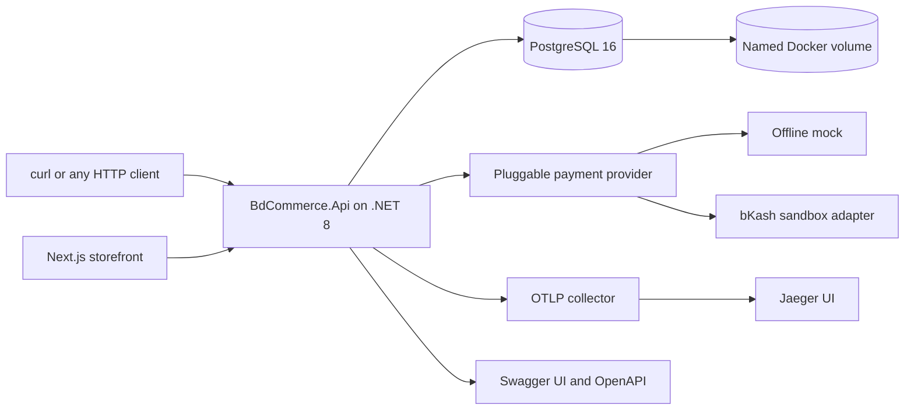

# BD Commerce API

A runnable commerce backend and storefront for developers who want a complete, local-first reference stack: a .NET 8 minimal API, PostgreSQL 16 persistence, a deterministic sandbox payment flow, and distributed tracing you can inspect in Jaeger. Clone the repository, start one Compose stack, and drive the full catalog, order, and payment lifecycle through real HTTP routes.

[](https://github.com/ibraramin/bd-commerce-api/actions/workflows/ci.yml)    

[](https://github.com/ibraramin/bd-commerce-api/releases/download/v0.1.0/brag.mp4)

[Watch the 20-second launch video](https://github.com/ibraramin/bd-commerce-api/releases/download/v0.1.0/brag.mp4)


## Key capabilities

- **.NET 8 minimal API** with FluentValidation request checks, `application/problem+json` validation responses, Swagger UI, and a golden-snapshot OpenAPI contract suite.
- **PostgreSQL 16** through EF Core and Npgsql. The app creates its schema and seeds five BDT-priced products on startup; Compose keeps data in a named volume.
- **Order flow** that computes line totals server-side from the catalog, returns `201 Created` with a `Location` header, and exposes integer-id order lookup.
- **Sandbox payment intents** with idempotent initiation, HMAC-SHA256 callbacks verified against the exact raw request bytes, and a pluggable provider abstraction shaped for bKash and Nagad sandbox checkouts. The offline mock and the bKash sandbox adapter make no processor calls and move no money, and credentials are read only from environment variables.
- **Next.js 15 storefront** in `web/` with a product listing, a checkout form, and an order status page, all calling the same API routes.
- **OpenTelemetry tracing** with automatic ASP.NET Core request spans plus named `products.list`, `orders.create`, and `payments.initiate` spans, exported over OTLP/gRPC to a local collector and viewed in Jaeger.

## Demo


A 21-second recording of the real browse, order, payment initiation, and order lookup flow. Every response comes from the local Compose stack.

## Quickstart

Prerequisites:

- .NET SDK 8.0 (CI uses `8.0.x`)
- Docker with the daemon running and Docker Compose
- `curl` and `openssl` for the examples below
- Node.js 20 and npm for the storefront only

Start the full stack:

```bash
git clone https://github.com/ibraramin/bd-commerce-api.git
cd bd-commerce-api
docker compose up --build
```

The API listens at <http://localhost:8080>. Swagger UI is at <http://localhost:8080/swagger> and the OpenAPI document is at <http://localhost:8080/swagger/v1/swagger.json>.

Start the storefront in a second terminal:

```bash
cd web
npm ci
NEXT_PUBLIC_API_BASE_URL=http://localhost:8080 npm run dev
```

The storefront is at <http://localhost:3000>.

Run the test suite. The integration tests start a PostgreSQL 16 container through Testcontainers, so the Docker daemon must be available:

```bash
dotnet test tests/BdCommerce.Api.Tests/BdCommerce.Api.Tests.csproj -c Release
```

To run the API without Compose, set the variables from the table below and use `dotnet run --project src/BdCommerce.Api`.

### Configuration

Compose reads these from the shell and supplies development defaults when they are unset.

| Variable | Default in Compose | Purpose |
| --- | --- | --- |
| `ConnectionStrings__Default` | `Host=postgres;Port=5432;Database=bdcommerce;Username=postgres;Password=postgres` | Npgsql connection string used by EF Core |
| `Payment__Provider` | `Mock` | Provider selection. Only the explicit value `BkashSandbox` selects the sandbox adapter; every other value keeps the flow offline |
| `Payment__WebhookSecret` | `local-dev-secret-change-me` | HMAC-SHA256 secret used to verify `X-Signature` on payment callbacks |
| `POSTGRES_DB`, `POSTGRES_USER`, `POSTGRES_PASSWORD` | `bdcommerce`, `postgres`, `postgres` | PostgreSQL container credentials |

## API examples

The order body is `samples/order.json` (product 1, quantity 2, total 3000 BDT). Replace the example values with IDs from earlier responses. Payment initiation takes integer `orderId` values, and callbacks take the GUID `paymentIntentId` returned by initiation.

```bash
BASE=http://localhost:8080

# Health
curl -sS "$BASE/health"

# Seeded catalog
curl -sS "$BASE/api/v1/products"

# Create an order (201 Created, with a Location header)
curl -sS -i -X POST "$BASE/api/v1/orders" \
  -H 'Content-Type: application/json' \
  --data-binary @samples/order.json

# Fetch an order by its integer id
curl -sS "$BASE/api/v1/orders/1"

# Initiate a sandbox payment intent. Reusing the key returns the same intent.
curl -sS -X POST "$BASE/api/v1/payments/initiate" \
  -H 'Content-Type: application/json' \
  -d '{"orderId":1,"amount":3000.00,"idempotencyKey":"demo-key-1"}'

# Send a signed callback. The signature is lowercase hex HMAC-SHA256 of the raw body.
BODY='{"paymentIntentId":"<paymentIntentId from initiate>","status":"succeeded"}'
SECRET=${Payment__WebhookSecret:-local-dev-secret-change-me}
SIG=$(printf '%s' "$BODY" | openssl dgst -sha256 -hmac "$SECRET" -hex | awk '{print $NF}')
curl -sS -X POST "$BASE/api/v1/payments/callback" \
  -H 'Content-Type: application/json' \
  -H "X-Signature: $SIG" \
  -d "$BODY"

# OpenAPI document
curl -sS "$BASE/swagger/v1/swagger.json"
```

The signature is computed over the exact bytes sent. Any change in whitespace or property order changes the signature.

## Architecture



The same four Compose services used for the load run and demo are `api`, `postgres`, `otel-collector`, and `jaeger`. The image can also be built on its own with `docker build -t bd-commerce-api:local .`.

## Observability

Compose runs an OpenTelemetry Collector and Jaeger all-in-one beside the API and PostgreSQL. The collector receives OTLP on gRPC 4317 and HTTP 4318 and forwards traces to Jaeger in the same network. The OTLP exporter registers only when `OTEL_EXPORTER_OTLP_ENDPOINT` is set, so plain `dotnet run` and the tests never try to reach a collector. The collector ports and the Jaeger UI on 16686 bind to host loopback only.

Open the Jaeger UI at <http://127.0.0.1:16686>. A query against that local instance returned 20 traces whose spans include the automatic `GET /api/v1/products` and `GET /health` operations and the named `products.list` span under the `bd-commerce-api` service. The recorded evidence is in `results/tracing-evidence.json` and `results/jaeger-traces.json`, and the Compose state at run time is in `results/compose-state-at-run.json`.

## Benchmarks

All figures below are local Compose measurements, not claims about a hosted service.

Canonical scenario in `load/k6.js`: a `ramping-vus` executor (0 to 10 VUs over 10 s, hold 10 VUs for 20 s, ramp down over 5 s, 2 s graceful stop) checking `/health`, `/api/v1/products`, order create and get, and payment initiation. Run with k6 v2.4.0 (`grafana/k6:latest`) and Docker 29.9.1 against an isolated local Compose stack. Hardware: AMD Ryzen 7 6800HS, 16 logical CPUs, 14 GiB RAM, Linux x86_64. Exit code 0.

| Metric | Observed |
| --- | --- |
| HTTP requests | 6502 (183.93 req/s) |
| Error rate (`http_req_failed`) | 0.00% (0 of 6502) |
| Checks | 6500 / 6500 passed (100%) |
| Request duration avg / median | 1.95 ms / 1.03 ms |
| Request duration p90 / p95 | 5.40 ms / 6.19 ms |
| Request duration max | 211.36 ms |
| Max virtual users | 10 |
| Wall clock / complete iterations | 35.4 s / 1300 |

Thresholds `rate<0.01` on `http_req_failed`, `p(95)<2000` ms on `http_req_duration`, and `rate>0.99` on `checks` were all satisfied. k6 v2.4.0 does not export p99. The machine-readable export is `results/k6-summary.json`, and the full write-up with the exact command is `results/LOAD-RESULTS.md`.

A separate local observation with ApacheBench (`ab -n 1000 -c 20`) against `GET /api/v1/products` recorded 4969.68 req/s with p50 3 ms, p95 4 ms, p99 18 ms, and zero failed requests on the same machine. ApacheBench and k6 use different clients and load models, so these two sets of figures are not comparable and are kept separate.

## Scope and deployment

Deployment is reproducible from source. `docker compose up --build` starts the API, PostgreSQL, the collector, and Jaeger on loopback; `docker build -t bd-commerce-api:local .` builds the API image alone; and the `web/` app builds with `npm ci` and `npm run build`. No hosted endpoint is published for this repository, so every command and example here targets localhost.

The payment flow is sandbox only. The provider registry selects the offline mock unless `Payment__Provider=BkashSandbox` is set explicitly, credentials come from environment variables, and no money moves. The API has no authentication or role-based access control, so keep the stack on a trusted network and replace the development webhook secret and PostgreSQL password before adapting it beyond local use.

## License and links

- License: MIT. Copyright (c) 2026 Ibrar Amin. See `LICENSE`.
- Repository: <https://github.com/ibraramin/bd-commerce-api>
- CI workflow: <https://github.com/ibraramin/bd-commerce-api/actions/workflows/ci.yml>
- Load results: `results/LOAD-RESULTS.md`
- Load scenario: `load/k6.js`
- Storefront: `web/`
- Golden OpenAPI contract: `tests/BdCommerce.Api.Tests/Golden/openapi-v1.json`
