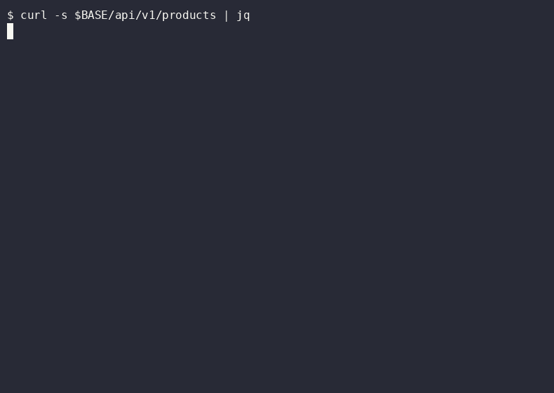
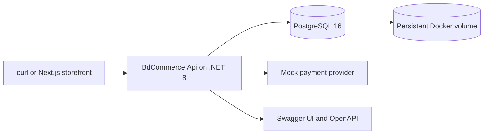

# BD Commerce API

A .NET 8 minimal API for a product catalog, order placement, and a sandboxed payment intent flow backed by PostgreSQL and a mock payment provider. A Next.js storefront lives in `web/`.

[](https://github.com/ibraramin/bd-commerce-api/actions/workflows/ci.yml)   

## Demo



A 21-second recording of the real browse to checkout to order-status flow: product list, `POST /orders`, payment initiation, and final order lookup. The Python/jq output is live from the compose stack, not canned data.

## Prerequisites

- .NET SDK 8.0.428 at `$HOME/.dotnet`
- Docker with the Docker daemon running and Docker Compose
- `curl` and `openssl` for the examples below

## Setup

1. Put the SDK on `PATH` and restore:

   ```bash
   export PATH="$HOME/.dotnet:$PATH"
   dotnet restore
   ```

2. Run the API and PostgreSQL together:

   ```bash
   docker compose up --build
   ```

   The API listens on `http://localhost:8080`. Swagger UI is at `http://localhost:8080/swagger` and the OpenAPI document is at `http://localhost:8080/swagger/v1/swagger.json`.

   To run the API directly instead, export the variables in the table below and use:

   ```bash
   dotnet run --project src/BdCommerce.Api
   ```

3. Run the integration tests. They start a real PostgreSQL 16 container through Testcontainers, so the Docker daemon must be available:

   ```bash
   dotnet test tests/BdCommerce.Api.Tests/BdCommerce.Api.Tests.csproj -c Release
   ```

## Environment variables

| Variable | Required | Default | Purpose |
| --- | --- | --- | --- |
| `ConnectionStrings__Default` | Yes for local runs | `Host=postgres;Port=5432;Database=bdcommerce;Username=postgres;Password=postgres` in Compose | Npgsql connection string used by EF Core |
| `Payment__Provider` | No | `Mock` | Payment provider implementation. `Mock` keeps the flow entirely in sandbox |
| `Payment__WebhookSecret` | Yes in deployed environments | `local-dev-secret-change-me` in Compose | HMAC-SHA256 secret used to verify `X-Signature` on payment callbacks |

Compose reads these from the shell environment and supplies development defaults when they are unset. Set a real secret before deploying anywhere.

## Sample requests

The order body comes from `samples/order.json`. Replace the example product id with one returned by `GET /api/v1/products`, and replace `{id}` and `{paymentIntentId}` with values from earlier responses.

```bash
# Health
curl -sS http://localhost:8080/health

# Products
curl -sS http://localhost:8080/api/v1/products

# Create an order
curl -sS -X POST http://localhost:8080/api/v1/orders \
  -H 'Content-Type: application/json' \
  --data-binary @samples/order.json

# Fetch an order
curl -sS http://localhost:8080/api/v1/orders/{id}

# Initiate a payment (repeat with the same idempotencyKey to get the same intent)
curl -sS -X POST http://localhost:8080/api/v1/payments/initiate \
  -H 'Content-Type: application/json' \
  -d '{"orderId":"{id}","amount":42.00,"idempotencyKey":"demo-key-1"}'

# Send a payment callback signed with the webhook secret
BODY='{"paymentIntentId":"{paymentIntentId}","status":"succeeded"}'
SIGNATURE=$(printf '%s' "$BODY" | openssl dgst -sha256 -hmac "$Payment__WebhookSecret" -hex | awk '{print $NF}')
curl -sS -X POST http://localhost:8080/api/v1/payments/callback \
  -H 'Content-Type: application/json' \
  -H "X-Signature: $SIGNATURE" \
  -d "$BODY"

# OpenAPI document
curl -sS http://localhost:8080/swagger/v1/swagger.json
```

The callback signature is the lowercase hex HMAC-SHA256 of the raw request body. Any whitespace change in the body changes the signature.

## Architecture



## Benchmarks

Measured 2026-11-25 against `GET /api/v1/products` on a locally composed api + PostgreSQL 16 stack. Command: `ab -n 1000 -c 20 http://127.0.0.1:8080/api/v1/products` (ApacheBench 2.3). Hardware: AMD Ryzen 7 6800HS Creator Edition, x86_64, 16 logical CPUs. These are real observations from that run, not estimates; a deployed-host measurement is still required for the live URL.

| Metric | Value | Tool | Concurrency | Hardware |
| --- | --- | --- | --- | --- |
| Requests per second | 4969.68 | ApacheBench 2.3 (`ab -n 1000 -c 20`) | 20 | AMD Ryzen 7 6800HS, x86_64, 16 logical CPUs |
| p50 latency (ms) | 3 | ApacheBench 2.3 | 20 | AMD Ryzen 7 6800HS, x86_64, 16 logical CPUs |
| p95 latency (ms) | 4 | ApacheBench 2.3 | 20 | AMD Ryzen 7 6800HS, x86_64, 16 logical CPUs |
| p99 latency (ms) | 18 | ApacheBench 2.3 | 20 | AMD Ryzen 7 6800HS, x86_64, 16 logical CPUs |
| Error rate (%) | 0 | ApacheBench 2.3 (`Failed requests: 0`) | 20 | AMD Ryzen 7 6800HS, x86_64, 16 logical CPUs |

## Limitations

- Sandbox only. The mock payment provider does not contact a real processor and no money moves.
- No authentication or role based access control. Every endpoint is anonymous, so do not expose this service to untrusted networks.
- No hosted deployment by design. The GitHub repository at <https://github.com/ibraramin/bd-commerce-api> is the canonical home; run the stack locally with `docker compose up --build`. All API examples in this README were executed against that local stack.

## License

MIT. See `LICENSE`. Copyright 2026 Ibrar Amin.
