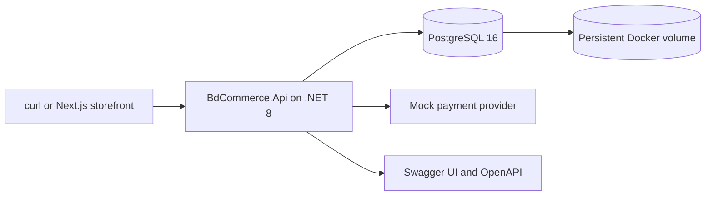

# BD Commerce API

A .NET 8 minimal API for a product catalog, order placement, and a sandboxed payment intent flow backed by PostgreSQL and a mock payment provider. A Next.js storefront lives in `web/`.

[](https://github.com/ibraramin/bd-commerce-api/actions/workflows/ci.yml)   

## Demo


A 21-second recording of the real browse to checkout to order-status flow: product list, `POST /orders`, payment initiation, and final order lookup. The Python/jq output comes from the local Compose stack, not canned data.

## Prerequisites

- .NET SDK 8.0.428 at `$HOME/.dotnet`
- Docker with the Docker daemon running and Docker Compose
- `curl` and `openssl` for the examples below

## Setup

1. Put the SDK on `PATH` and restore:

   ```bash
   export PATH="$HOME/.dotnet:$PATH"
   dotnet restore
   ```

2. Run the API, PostgreSQL and the local tracing stack together:

   ```bash
   docker compose up --build
   ```

   The API listens on `http://localhost:8080`. Swagger UI is at `http://localhost:8080/swagger` and the OpenAPI document is at `http://localhost:8080/swagger/v1/swagger.json`. Every URL in this README is loopback-only (`localhost` / `127.0.0.1`): there is no live URL and no hosted deployment for this project. The whole stack is sandbox/local only.

   To run the API directly instead, export the variables in the table below and use:

   ```bash
   dotnet run --project src/BdCommerce.Api
   ```

3. Run the tests. The integration tests start a real PostgreSQL 16 container through Testcontainers, so the Docker daemon must be available:

   ```bash
   dotnet test tests/BdCommerce.Api.Tests/BdCommerce.Api.Tests.csproj -c Release
   ```

   OpenAPI contract checks live in the same project, in `tests/BdCommerce.Api.Tests/OpenApiContractTests.cs` (27 distinct cases). They use the in-process `ApiFixture` to fetch the generated `/swagger/v1/swagger.json` and assert the OpenAPI version and info, the exact path set, operation ids and tags, documented status codes, component schema properties, success-response shapes, the absence of security schemes, and `application/problem+json` validation errors. `GeneratedDocument_MatchesCommittedGoldenSnapshot` canonicalizes and diffs the generated document against the committed golden snapshot `tests/BdCommerce.Api.Tests/Golden/openapi-v1.json`, captured from the running app, so schema drift fails the suite. Both `dotnet test -c Release` (solution level) and `dotnet test tests/BdCommerce.Api.Tests -c Release` pass 36/36 tests (27 contract + 9 existing tests). The former standalone `tests/BdCommerce.Api.ContractTests/` project was removed: four distinct cases were folded into this suite and 17 duplicates dropped.

## Environment variables

| Variable | Required | Default | Purpose |
| --- | --- | --- | --- |
| `ConnectionStrings__Default` | Yes for local runs | `Host=postgres;Port=5432;Database=bdcommerce;Username=postgres;Password=postgres` in Compose | Npgsql connection string used by EF Core |
| `Payment__Provider` | No | `Mock` | Payment provider implementation. `Mock` keeps the flow entirely in sandbox |
| `Payment__WebhookSecret` | Development default in Compose | `local-dev-secret-change-me` in Compose | HMAC-SHA256 secret used to verify `X-Signature` on payment callbacks |

Compose reads these from the shell environment and supplies development defaults when they are unset. There is no hosted deployment in this project. If you adapt this stack for a real deployment, replace the development webhook secret and the default PostgreSQL password first.

## Sample requests

The order body comes from `samples/order.json`. Replace the example product id with one returned by `GET /api/v1/products`, and replace `{id}` and `{paymentIntentId}` with values from earlier responses.

```bash
# Health
curl -sS http://localhost:8080/health

# Products
curl -sS http://localhost:8080/api/v1/products

# Create an order
curl -sS -X POST http://localhost:8080/api/v1/orders \
  -H 'Content-Type: application/json' \
  --data-binary @samples/order.json

# Fetch an order
curl -sS http://localhost:8080/api/v1/orders/{id}

# Initiate a payment (repeat with the same idempotencyKey to get the same intent)
curl -sS -X POST http://localhost:8080/api/v1/payments/initiate \
  -H 'Content-Type: application/json' \
  -d '{"orderId":"{id}","amount":42.00,"idempotencyKey":"demo-key-1"}'

# Send a payment callback signed with the webhook secret
BODY='{"paymentIntentId":"{paymentIntentId}","status":"succeeded"}'
SIGNATURE=$(printf '%s' "$BODY" | openssl dgst -sha256 -hmac "$Payment__WebhookSecret" -hex | awk '{print $NF}')
curl -sS -X POST http://localhost:8080/api/v1/payments/callback \
  -H 'Content-Type: application/json' \
  -H "X-Signature: $SIGNATURE" \
  -d "$BODY"

# OpenAPI document
curl -sS http://localhost:8080/swagger/v1/swagger.json
```

The callback signature is the lowercase hex HMAC-SHA256 of the raw request body. Any whitespace change in the body changes the signature.

## Architecture



### Tracing (local only)

Tracing stays inside this Compose stack. `docker-compose.yml` runs an OpenTelemetry Collector (`otel-collector`) and Jaeger all-in-one (`jaeger`) alongside the API and PostgreSQL. `otel-collector-config.yaml` receives OTLP on gRPC 4317 / HTTP 4318 and forwards traces to the in-network Jaeger instance; Compose sets `OTEL_EXPORTER_OTLP_ENDPOINT=http://otel-collector:4317` for the API. The OTLP exporter is registered only when that variable is set, so plain `dotnet run` and tests never try to reach a collector. The collector ports and the Jaeger UI on 16686 are bound to host loopback (`127.0.0.1`) only. Jaeger UI: <http://127.0.0.1:16686>. There is no hosted or cloud tracing endpoint.

This path is verified against real Jaeger query evidence, not just configuration: `results/tracing-evidence.json` records a query of `http://127.0.0.1:16686/api/traces?service=bd-commerce-api&limit=20` from the earlier external-writer Compose run (loopback 18080 / Jaeger 16686), which returned 20 traces / 30 spans with verdict `PASS`; the raw response is `results/jaeger-traces.json`. That predates the canonical fork load run below (18081 / Jaeger 16687), whose own wire-up re-check is recorded in `results/LOAD-RESULTS.md` under "Observability wire-up confirmation". The spans include the auto-instrumented `GET /api/v1/products` and `GET /health` operations and the explicit `products.list` ActivitySource span, all under the `bd-commerce-api` service. `results/compose-state-at-run.json` records the four running local containers (api, postgres, otel-collector, jaeger) at run time.

## Benchmarks

All load figures in this README are local-Compose results, not measurements of a public service. There is no live URL and no hosted deployment for this project; a measurement against a hosted deployment would be required before making any hosted-performance claim, and none is made here.

### Earlier ApacheBench snapshot (2026-11-25)

Recorded against `GET /api/v1/products` on a locally composed api + PostgreSQL 16 stack with `ab -n 1000 -c 20 http://127.0.0.1:8080/api/v1/products` (ApacheBench 2.3) on AMD Ryzen 7 6800HS Creator Edition, x86_64, 16 logical CPUs. These are real observations from that local run, not estimates.

| Metric | Value | Tool | Concurrency | Hardware |
| --- | --- | --- | --- | --- |
| Requests per second | 4969.68 | ApacheBench 2.3 (`ab -n 1000 -c 20`) | 20 | AMD Ryzen 7 6800HS, x86_64, 16 logical CPUs |
| p50 latency (ms) | 3 | ApacheBench 2.3 | 20 | AMD Ryzen 7 6800HS, x86_64, 16 logical CPUs |
| p95 latency (ms) | 4 | ApacheBench 2.3 | 20 | AMD Ryzen 7 6800HS, x86_64, 16 logical CPUs |
| p99 latency (ms) | 18 | ApacheBench 2.3 | 20 | AMD Ryzen 7 6800HS, x86_64, 16 logical CPUs |
| Error rate (%) | 0 | ApacheBench 2.3 (`Failed requests: 0`) | 20 | AMD Ryzen 7 6800HS, x86_64, 16 logical CPUs |

### Local k6 load run — canonical scenario (2026-11-26)

`load/k6.js` is the canonical scenario: a `ramping-vus` executor (0 -> 10 VUs over 10 s, hold 10 VUs for 20 s, ramp down over 5 s, 2 s graceful stop) checking `/health`, `/api/v1/products`, order create/get and payment initiation. It ran against the isolated local Compose stack on loopback port 18081 with k6 v2.4.0 (`grafana/k6:latest`) and Docker 29.9.1. The exact command (including `docker run --user "$(id -u):$(id -g)"` so the summary could be exported) and full context are in `results/LOAD-RESULTS.md`; installation provenance is in `results/k6-provenance.json`; the Compose state at run time is in `results/compose-state-at-run.json`. Exit code 0.

Hardware: AMD Ryzen 7 6800HS, 16 logical CPUs, 14 GiB RAM, Linux 7.2.11-1-cachyos x86_64. Wall clock 35.4 s, 1300 complete iterations.

| Metric | Observed | Source |
| --- | --- | --- |
| HTTP requests | 6502 (183.93 req/s) | `results/k6-summary.json` |
| Error rate (`http_req_failed`) | 0.00% (0 / 6502) | `results/k6-summary.json` |
| Checks | 6500 / 6500 passed (100%) | `results/k6-summary.json` |
| Request duration avg / median | 1.95 ms / 1.03 ms | `results/k6-summary.json` |
| Request duration p95 | 6.19 ms | `results/k6-summary.json` |
| Request duration max | 211.36 ms | `results/k6-summary.json` |
| Max virtual users | 10 | `results/k6-summary.json` |

Thresholds declared in `load/k6.js` — `http_req_failed` rate < 0.01, `http_req_duration` p(95) < 2000 ms, `checks` rate > 0.99 — were all satisfied and the run exited 0. The `thresholds` booleans in the `--summary-export` JSON are breach flags: `false` means the threshold was **not** breached, i.e. it passed. k6 v2.4.0 does not export p99, so no p99 figure is stated.

#### Superseded external-baseline run (reference only)

An earlier 5-VU / 30 s smoke script with a 1 s sleep per iteration was written concurrently by an external party; its provenance was ambiguous, so it is **superseded** by the canonical run above. It is preserved verbatim at `load/k6.external-baseline.js`, with its export at `results/k6-summary.external-baseline.json`. Its figures (reference only, not the current result): 300 requests, 0 failed; 450/450 checks; p95 4.09 ms; mean 1.42 ms; 5 VUs; 150 iterations; ~9.96 req/s.

The ApacheBench and k6 figures are not comparable and must not be merged. The ~4970 rps number is a 20-concurrency `ab` throughput observation; the canonical k6 figures come from a different client, load model (ramping VUs) and endpoint mix. Neither is a measurement of a hosted deployment, and none of these results support any claim about a live or hosted service.

## Limitations

- Sandbox only. The mock payment provider does not contact a real processor and no money moves; the bKash/Nagad pieces are sandbox adapter scaffolding, not live payment integrations.
- No authentication or role based access control. Every endpoint is anonymous, including `/health`, the `/api/v1/*` routes and the Swagger UI, so do not expose this service to untrusted networks.
- No live URL and no hosted deployment by design. The GitHub repository at <https://github.com/ibraramin/bd-commerce-api> is the canonical home; run the stack locally with `docker compose up --build`. All API examples in this README were executed against that local stack.

## License

MIT. See `LICENSE`. Copyright 2026 Ibrar Amin.
